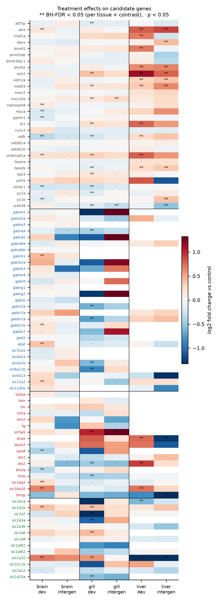
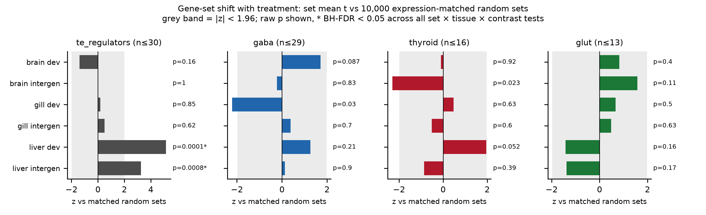
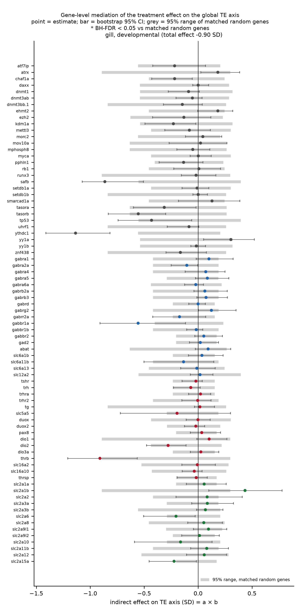
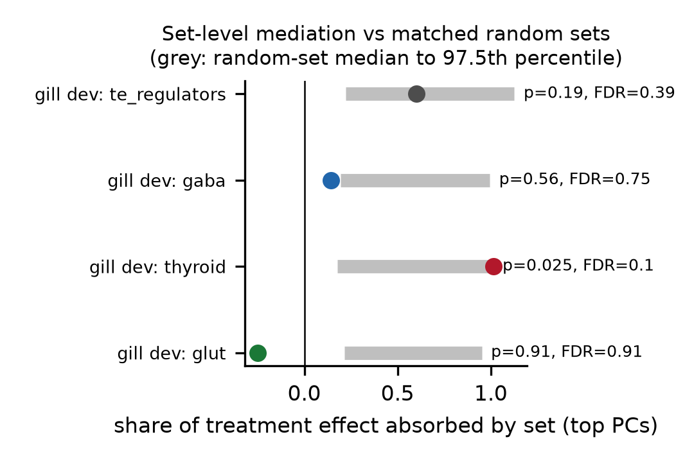
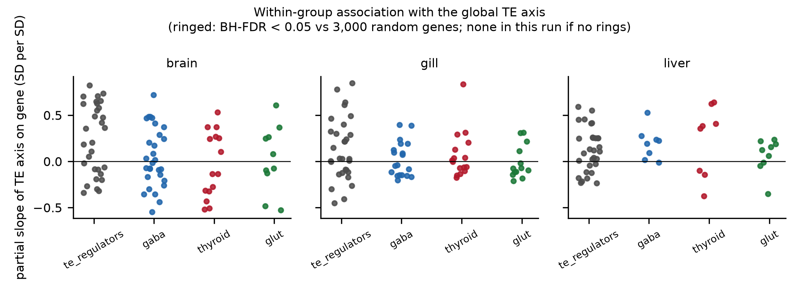

# Candidate gene sets and the CO2-driven shift in gill TE load

*Acanthochromis polyacanthus*, 162 bulk RNA-seq libraries · `scripts/07_treatment_gene_axis.py` ·
gene sets in `config/gene_sets_apoly.yaml` · run 2026-10-01 on thinkstation2 (CPU)

Status: exploratory and not prespecified. It follows from
[`../2026-10-01_te_axis_treatment/REPORT.md`](../2026-10-01_te_axis_treatment/REPORT.md),
which found that developmental CO2 exposure lowers the gill TE read share by
11.4% [5.1, 17.2] (FDR 0.006).

## Abstract

We asked whether four candidate gene sets respond to CO2 exposure, and
whether any of them accounts for the drop in gill TE load:

| Set | Genes in annotation |
|---|---|
| TE silencers and regulators | 30 |
| GABA signalling | 29 |
| Thyroid hormone axis | 18 |
| Facilitative glucose transporters (GLUT/*slc2a*) | 15 |

Every gene was tested with the frozen family-adjusted model. Every set-level
claim was compared with expression-matched random genes, because the global
TE axis correlates with much of the transcriptome.

Developmental exposure changed many candidate genes. Liver showed a
coordinated rise of the TE-regulator set (set z = +5.1 against random sets,
FDR 0.002; *ezh2*, *atrx*, *dnmt1*, *ehmt2* and *kdm1a* all up). In gill,
18 of 19 expressed GABA genes went down (binomial p = 1e-4), though as a set
this was only nominal against random genes (z = −2.2, p = 0.03, FDR 0.18).
The thyroid and glucose-transport genes gave strong single-gene responses
but no coherent set shift.

None of these changes explained the gill TE-load decrease better than random
genes did. No single gene beat the random-gene null after correction (lowest
FDR 0.58). The thyroid set came closest: its leading components absorbed all
of the gill effect against a random-set median of 18% (p = 0.025, FDR 0.10).
It is a lead for a directed experiment and does not by itself show mediation.

## Methods

**Data.** Counts are the 162 single-batch TEcount tables from the OA study.
Expression is log2(count/size factor + 1), with size factors computed from
gene rows only. A gene enters a tissue's analysis if its mean raw count in
that tissue is at least 10. The TE axis is the per-library score from
`06_te_axis_treatment.py`.

**Model.** Each tissue (n = 54) is fitted with
`log2 expression ~ family line + treatment`, where family line is the
parental pair nested in phenotype, as in the frozen OA design. The two
contrasts are developmental vs control and intergenerational vs control.
BH-FDR is applied across the candidate genes within each tissue × contrast.

**Set-level shift (competitive test).** For each set, we take the mean
t-statistic of its genes and compare it with 10,000 random sets. Each random
set replaces every set gene with a random gene from the same expression
decile. The p-value is two-sided, and BH-FDR runs across all
set × tissue × contrast tests.

**Association with the TE axis.** Within each tissue, the TE axis is
regressed on family, treatment and the standardized gene. The empirical p
compares the gene's |slope| with 3,000 random genes, (1 + #random ≥ obs)/(1 + N),
with BH across candidate genes.

**Mediation.** For a treatment effect *c* on the TE axis, adding a gene
changes it to *c′ = c − a·b*. Here *a* is the treatment effect on the gene
and *b* is the gene's partial slope on the axis; this is an exact OLS
identity. The indirect effect *a·b* gets a 95% CI from 1,000 bootstrap
resamples of fish within family × treatment cells, and an empirical p
against random genes from the same expression decile. Set-level mediation
adds a set's top three principal components together and is compared with
1,000 matched random sets.

Mediation is reported only where the total effect is significant
(*p* < 0.05). Here that is gill, developmental vs control (−0.90 SD,
p = 0.001). A proportion of a null effect has no meaning: two contrasts with
non-significant totals gave "significant" set-level mediation before this
rule was added.

These mediation estimates are statistical. They assume no unmeasured
confounding between gene and TE axis, and the global-axis structure makes
that assumption doubtful, so every result here is judged against random
genes instead of against zero.

## Results

### 1. Treatment effects on the candidate genes



*Figure 1. log2 fold change vs control for every expressed candidate gene,
by tissue and contrast. \*\* BH-FDR < 0.05 within tissue × contrast;
· nominal p < 0.05. Grey cells: gene not expressed in that tissue.*

Genes at FDR < 0.05 (of those expressed):

| Set | Brain dev | Brain intergen | Gill dev | Gill intergen | Liver dev | Liver intergen |
|---|---|---|---|---|---|---|
| TE regulators | 8/30 | 0/30 | 12/30 | 2/30 | 11/30 | 9/30 |
| GABA | 4/29 | 0/29 | 5/19 | 0/19 | 0/8 | 0/8 |
| Thyroid | 4/15 | 0/15 | 3/16 | 1/16 | 3/8 | 2/8 |
| GLUT | 2/10 | 0/10 | 6/13 | 0/13 | 2/9 | 1/9 |

Most responses come from developmental exposure. Intergenerational
contrasts have about 3.6 effective replicates per group and few genes pass
FDR. Selected effects, as log2FC [95% CI], p, FDR:

- Liver TE regulators go up.
  - *ezh2* +1.14 [0.79, 1.50], p < 1e-6, FDR < 1e-4.
  - *atrx* +0.81 [0.55, 1.06], FDR < 1e-4.
  - *dnmt1* +0.69 [0.30, 1.07], FDR 0.004.
  - Most of these persist in the intergenerational group: *atrx* +0.89,
    FDR 0.001; *ezh2* +0.78, FDR 0.04.
- Gill GABA genes go down.
  - *gabbr1a* −0.71 [−0.95, −0.47], FDR < 1e-4.
  - The GABA transporter *slc6a11b* −0.85 [−1.23, −0.48], FDR 4e-4.
  - *gabra4* −0.42, FDR 0.025; *gabrr2a* −0.64, FDR 0.027; *slc6a1b* −0.59,
    FDR 0.046.
  - In brain, developmental exposure instead raised *abat* (+0.37,
    FDR < 1e-4), *slc12a2*/NKCC1 (+0.27, FDR 0.001) and *gabrb1* (+0.42,
    FDR 0.006).
- Thyroid axis:
  - Gill: the iodide transporter *slc5a5*/NIS rises (+1.02 [0.64, 1.40],
    FDR 1e-4; intergenerational +1.30, FDR 0.007), while *thrb* (−0.45,
    FDR 3e-4) and *dio2* (−0.47, FDR 0.004) fall.
  - Liver: *thrsp*, a thyroid-hormone-responsive gene, drops by −3.93 log2
    [−5.29, −2.57] in the intergenerational group (FDR < 1e-4).
  - Brain: *dio3a* falls (−0.38, FDR 0.005).
- Glucose transporters:
  - *slc2a1b* rises in brain (+0.39, FDR < 1e-4) and gill (+0.37,
    FDR < 1e-4).
  - *slc2a2* falls in gill (−1.58, FDR 0.001).
  - *slc2a10* goes up in brain and gill but down sharply in liver
    (intergenerational −4.33 [−6.14, −2.51], FDR 5e-4).

### 2. Do the sets shift as a whole?



*Figure 2. Set mean t compared with 10,000 expression-matched random sets
(z score). The grey band marks |z| < 1.96; raw p is shown and \* marks
BH-FDR < 0.05.*

| Tissue | Contrast | Set | n | z | p | FDR | Fraction of genes up |
|---|---|---|---|---|---|---|---|
| liver | developmental | TE regulators | 30 | **+5.14** | 0.0001 | **0.002** | 0.83 |
| liver | intergenerational | TE regulators | 30 | **+3.25** | 0.0008 | **0.010** | 0.60 |
| gill | developmental | GABA | 19 | −2.21 | 0.030 | 0.18 | 0.05 (binomial p = 1e-4) |
| brain | intergenerational | thyroid | 15 | −2.30 | 0.023 | 0.18 | 0.33 |
| liver | developmental | thyroid | 8 | +1.95 | 0.052 | 0.25 | 0.63 |

All other set × tissue × contrast tests have p > 0.08.

Only the liver TE-regulator rise survives correction. The gill GABA decrease
is unusually consistent (18 of 19 genes down) but is weaker against random
sets. That gap suggests part of it reflects a wider transcriptional shift in
gill, and the competitive test discounts that shift.

### 3. Do the genes account for the gill TE-load decrease?



*Figure 3. Indirect effect (a × b) of each candidate gene on the gill
developmental TE-axis shift (total −0.90 SD). Points are estimates, black
bars bootstrap 95% CIs, grey bars the 95% range of random genes from the
same expression decile.*

No gene beats the random-gene null after correction (lowest FDR 0.58). The
nominal leaders, all p_emp < 0.05:

| Gene | Set | a (SD) | b (SD/SD) | Indirect [95% CI] | Share mediated [95% CI] | p_emp | FDR |
|---|---|---|---|---|---|---|---|
| *ythdc1* | TE regulators | −1.34 | 0.85 | −1.14 [−1.41, −0.82] | 1.26 [0.90, 1.65] | 0.012 | 0.58 |
| *safb* | TE regulators | −1.11 | 0.78 | −0.86 [−1.07, −0.51] | 0.96 [0.55, 1.32] | 0.015 | 0.58 |
| *gabbr1a* | GABA | −1.44 | 0.39 | −0.56 [−0.91, −0.12] | 0.62 [0.14, 1.08] | 0.027 | 0.58 |
| *thrb* | thyroid | −1.09 | 0.84 | −0.91 [−1.21, −0.56] | 1.01 [0.58, 1.51] | 0.034 | 0.58 |
| *slc2a15a* | GLUT | −0.71 | 0.31 | −0.22 [−0.45, −0.02] | 0.25 [0.02, 0.56] | 0.037 | 0.58 |

Shares above 1 do not mean these genes cause more than the whole effect.
Under the global axis, almost any gene that falls with treatment and tracks
TE load reproduces the whole shift. The random-gene comparison is the test,
and none passes it.



*Figure 4. Share of the gill developmental effect absorbed by each set's top
principal components, compared with matched random sets.*

| Set | Share absorbed | Random-set median [97.5th pct] | p | FDR |
|---|---|---|---|---|
| **thyroid** | **1.01** | 0.18 [1.00] | **0.025** | 0.10 |
| TE regulators | 0.60 | 0.22 [1.13] | 0.19 | 0.39 |
| GABA | 0.14 | 0.19 [0.99] | 0.56 | 0.75 |
| GLUT | −0.25 | 0.21 [0.95] | 0.91 | 0.91 |

### 4. Association with the TE axis within groups



*Figure 5. Partial slope of the TE axis on each standardized gene, given
family and treatment.*

Many candidate genes correlate with the TE axis by parametric p (brain 28,
gill 10, liver 11 at FDR < 0.05). Against random genes, none does. In gill,
*ythdc1*, *thrb* and *safb* fall in the top 0.5% of 3,000 random genes
(p_emp 0.004 to 0.005), but BH across 78 genes leaves FDR 0.13. Most of the transcriptome co-varies with TE load in these
libraries, so these associations do not single out the candidate sets.

## Interpretation

1. CO2 exposure changes all four pathways, most clearly in liver and
   gill. Liver raises a coordinated set of TE-silencing and chromatin genes
   (*ezh2*, *atrx*, *dnmt1*, *ehmt2*, *kdm1a*) without any change in liver TE
   load (06). In gill, GABA receptor and transporter transcripts fall
   together, and the thyroid axis shifts toward iodide uptake (*slc5a5* up)
   with lower receptor and activating-deiodinase expression (*thrb*, *dio2*
   down).
2. None of these explains the gill TE-load decrease beyond what random
   genes explain. The gill shift is diffuse (06), and diffuse shifts are
   easy to "mediate" with any correlated gene. The random-gene control
   removes every candidate.
3. The thyroid set is the one lead worth testing directly. It absorbs
   the gill effect more than 97.5% of matched random sets (p = 0.025), and
   its genes respond to CO2 in gill. A direct test would manipulate thyroid
   status (T3/T4 or a deiodinase inhibitor) under CO2 and measure TE load;
   reanalysing these data cannot settle it.

## Limitations

- The analysis is exploratory and uses one cohort, with no
  prespecification and no replication.
- These are bulk tissues, so expression and TE changes may reflect cell
  composition.
  Gill composition is plastic under acid-base stress (ionocyte turnover),
  and that alone could move both.
- The mediation is not causal. With an observational mediator and a dominant
  global axis, sequential ignorability is unlikely to hold.
- Intergenerational contrasts have few replicates (about 3.6 effective per group);
  absence of evidence there is weak.
- Gene sets are defined from the teleost annotation by symbol. Paralogs
  absent from the annotation, or below the expression filter in a tissue,
  are missing (gill expresses 19 of 29 GABA genes; liver 8).

## Files

| File | Content |
|---|---|
| `tables/07_gene_treatment_effects.tsv` | Every candidate gene × tissue × contrast: log2FC, 95% CI, t, p, FDR, mean count |
| `tables/07_set_treatment_shift.tsv` | Set-level competitive tests: mean t, z vs null, two-sided p, FDR, fraction up with binomial p |
| `tables/07_gene_axis_association.tsv` | Partial slopes with 95% CI, parametric p/FDR, empirical p/FDR vs random genes |
| `tables/07_gene_mediation.tsv` | a, b, indirect effect with bootstrap CI, share mediated with CI, random-gene null range, p_emp, FDR (interpretable contrasts only) |
| `tables/07_set_mediation.tsv` | Set-level share absorbed, random-set null, p, FDR, interpretability flag |
| `figures/07_fig1` to `07_fig5` (`.png` 300 dpi, `.pdf` vector) | Figures above |
| `configs/fish_gene_axis_20261001.yaml` | Run configuration |

Reproduce:

```bash
.venv-bulk/bin/python scripts/07_treatment_gene_axis.py --config runs/fish_gene_axis_20261001.yaml --gene-sets config/gene_sets_apoly.yaml --n-random-sets 10000 --n-boot 1000 --n-random-genes 3000
```
