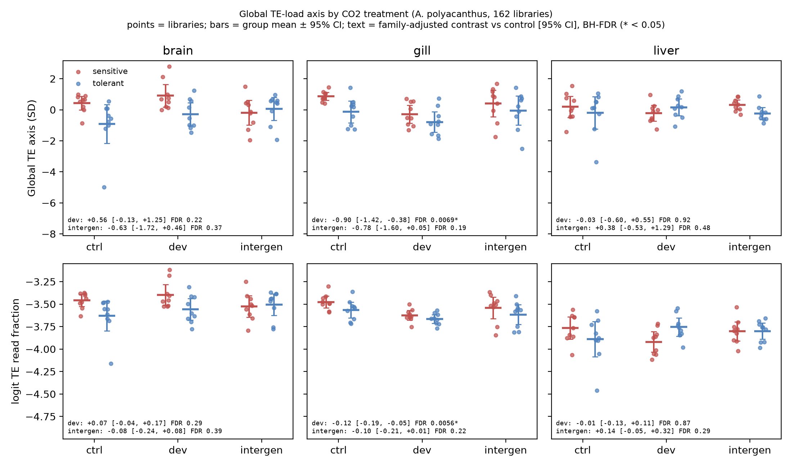
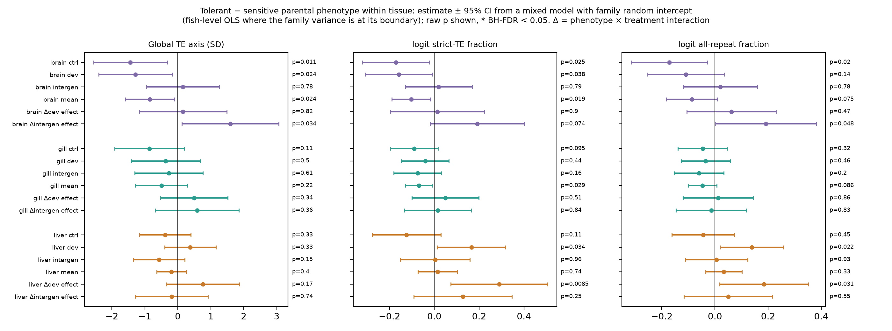

# Does CO2 exposure shift the global TE axis? *A. polyacanthus*, 162 libraries

**Date:** 2026-10-01 · **Script:** `scripts/06_te_axis_treatment.py` (final run at commit `d8a91aa`) ·
**Config:** `configs/fish_te_axis_treatment_20261001.yaml` · **Host:** thinkstation2 (CPU)

Status: exploratory analysis. It was not prespecified in the OA study
protocol, and its numbers are not part of the OA manuscript. Design changes it
triggered are logged as DC-07 to DC-10 in
[`../../DESIGN_CHANGES.md`](../../DESIGN_CHANGES.md).

## Summary

**Developmental CO2 exposure lowers the global TE share of the gill
transcriptome.** Strict-TE reads fall from 2.87% [2.72, 3.03] to 2.55%
[2.38, 2.73] of counted reads, a relative change of −11.4% [−17.2, −5.1]
(FDR 0.005). On the global TE axis the shift is −0.90 SD [−1.42, −0.38]
(FDR 0.007). The result:

- holds in both parental phenotypes;
- holds for all three measures;
- survives adjustment for alignment QC (−0.55 SD, FDR 0.008);
- survives exclusion of the 8 source-study outliers (−0.92 SD, FDR 0.008).

The intergenerational gill contrast points the same way and is of similar
size (−9.3% [−18.6, +1.0]), but is not significant (FDR 0.22). Its
effective replication is about 3.6 per group.

**Brain and liver show no robust shift.** Their QC-adjusted estimates
depend on QC covariates that themselves differ by treatment, so they are
reported as inconclusive.

**Tolerant and sensitive lines do not differ detectably in global TE
load.** No phenotype contrast or phenotype × treatment interaction survives
BH-FDR in any tissue or measure; the smallest FDR is 0.11. In gill the CO2
effect does not differ between phenotypes (interaction p = 0.34–0.86), so
the gill decrease reads as a common effect. The strongest nominal
difference is in brain, where tolerant fish sit below sensitive fish in
control (−1.44 SD [−2.55, −0.32], p = 0.011, FDR 0.15) and developmental
(p = 0.024) groups. It is consistent across measures but does not pass FDR.

**The shift is diffuse and mostly invisible to per-family DE.** Across
strata, the OA paper's significant TE hits move with their stratum's global
shift only modestly more often than chance (96/164 = 59%, binomial
p = 0.035). One stratum is fully aligned: brain, sensitive,
intergenerational vs developmental, with 13/13 hits following a −2.08 SD
shift (BH-FDR 0.004 across 17 strata).

## Background

`05_bulk_linear_isp.py` showed that one axis dominates within-stratum TE
variation in this cohort (`../2026-10-01_fish_bulk_isp/`, tables `05b_*`):

| Property | Value |
|---|---|
| TE PC1 share of within-stratum TE variance | 29.3% (PC2: 3.5%) |
| Families loading with the same sign | 96.8% (binomial vs 0.5: p < 1e-300) |
| r with TE read fraction | 0.87 [0.83, 0.91], p = 1e-48 |
| \|r\| with gene PC1 | 0.83 [0.77, 0.87], p = 9e-40 |
| r with multimapping % | −0.24 [−0.39, −0.09], p = 0.002 |
| r with unmapped % | +0.22 [+0.07, +0.37], p = 0.006 |
| r with unique-mapping % | −0.17 [−0.32, −0.01], p = 0.038 |
| r with library size | −0.16 [−0.31, 0.00], p = 0.050 |

Correlations use Fisher-z CIs with df = n − strata − 2 = 151. Libraries
higher on the axis have fewer multimapped and more unmapped reads. That
pattern fits a larger nascent or intronic RNA fraction better than a depth
artefact.

The ISP analysis centred data within tissue × treatment, so it could not see
whether treatment moves the axis. This report asks that question.

## Methods

**Data.** 162 TEcount tables (NAS `counts-singlebatch/all`), from the frozen
primary cohort: 3 tissues × 3 treatments × 2 parental phenotypes × 9 fish.
Size factors are DESeq2 median-of-ratios computed on gene rows only, followed
by log2(x/sf + 1). The axis uses strict-TE families only, excluding simple
repeats, low complexity, satellites and rRNA/tRNA/snRNA/scRNA/srpRNA; 2,205
families pass ≥10 counts in ≥10 libraries.

**Global TE measures** (one per library):

| Measure | Definition |
|---|---|
| `axis_score` | TE families standardized within tissue, projected onto the PC1 loadings of the *within tissue × treatment* PCA, oriented so positive = more TE, and z-scored. The loadings come from within-group variation, so treatment differences cannot shape the axis being tested. |
| `te_frac_strict` | logit(strict-TE counts / all counted reads) |
| `te_frac_all` | logit(all repeat-class counts / all counted reads) |

`axis_score` and `te_frac_strict` correlate r = 0.68.

**Models** (frozen OA protocol, section 5A). Family is the parental pair and
is partly confounded with treatment: families 1–2 are control and
developmental only, family 3 has all three treatments, and families 4–5 are
intergenerational only.

- **Primary (`tissue_pooled`):** per tissue, OLS `measure ~ C(phenotype:family) + C(treatment)`, n = 54, 46 residual df.
- **Stratified (`stratum_family`):** per tissue × phenotype, `measure ~ C(family) + C(treatment)`, n = 27.
- **Sensitivity:** the same models plus alignment QC (log STAR input reads, % unique, % multimapped, % unmapped; standardized within tissue). The primary model is also refit without the 8 source-study outliers (`tissue_pooled_no_outliers`).
- **Tolerant vs sensitive (per tissue).** Every family line belongs to one phenotype, so phenotype is fully confounded with family fixed effects. It is tested instead with a linear mixed model `measure ~ phenotype × treatment + (1 | family line)` (REML; Wald z CIs and p), n = 54 fish and 10 family lines per tissue. Where the family variance is estimated at its boundary or the fit does not converge, the model reduces to fish-level OLS, which is fitted explicitly (t-based; flagged `ols_boundary`). Contrasts: tolerant − sensitive within each treatment and averaged over treatments, plus the two interactions, i.e. the difference in each CO2 effect between phenotypes. As a conservative check, the same model is fitted by OLS on family × treatment means (18 units per tissue). BH-FDR is applied across 18 tests per method × measure.

Contrasts are developmental vs control and intergenerational vs control.
The intergenerational contrast rests mainly on family 3 (effective n ≈ 3.6
per group).

**Statistics.**

| Quantity | Method |
|---|---|
| Model estimates | 95% t-CI and two-sided p; BH-FDR within each model × measure set (6 tests for pooled, 12 for stratified) |
| Standardized effects | Estimate / residual SD |
| Absolute TE % | Inverse-logit of the control mean (95% t-CI) and of control mean + contrast (contrast 95% CI); baseline uncertainty is not propagated into the treated CI |
| Group means in the figure | 95% t-CI |
| DE alignment | Exact binomial test vs 0.5 per stratum, BH-FDR across strata, plus a pooled test |
| QC-by-treatment | The same family-adjusted model with each QC metric as the outcome, BH-FDR across all QC × tissue × contrast tests |

## Results

### 1. Primary model (per tissue, both phenotypes)



| Tissue | Contrast | Axis (SD) [95% CI] | p | FDR | Strict-TE share, % [95% CI] | Relative change [95% CI] | p | FDR |
|---|---|---|---|---|---|---|---|---|
| brain | control | — | — | — | 2.80 [2.57, 3.06] | — | — | — |
| brain | developmental | +0.56 [−0.13, +1.25] | 0.11 | 0.22 | 2.99 [2.71, 3.31] | +6.7% [−3.4, +17.9] | 0.19 | 0.29 |
| brain | intergenerational | −0.63 [−1.72, +0.46] | 0.25 | 0.37 | 2.59 [2.21, 3.04] | −7.5% [−21.1, +8.3] | 0.32 | 0.39 |
| gill | control | — | — | — | 2.87 [2.72, 3.03] | — | — | — |
| **gill** | **developmental** | **−0.90 [−1.42, −0.38]** | **0.0011** | **0.007** | **2.55 [2.38, 2.73]** | **−11.4% [−17.2, −5.1]** | **0.0009** | **0.006** |
| gill | intergenerational | −0.78 [−1.60, +0.05] | 0.064 | 0.19 | 2.60 [2.34, 2.90] | −9.3% [−18.6, +1.0] | 0.074 | 0.22 |
| liver | control | — | — | — | 2.13 [1.92, 2.37] | — | — | — |
| liver | developmental | −0.03 [−0.60, +0.55] | 0.92 | 0.92 | 2.11 [1.88, 2.37] | −0.9% [−11.7, +11.2] | 0.87 | 0.87 |
| liver | intergenerational | +0.38 [−0.53, +1.29] | 0.40 | 0.48 | 2.43 [2.03, 2.91] | +14.2% [−4.8, +36.8] | 0.15 | 0.29 |

p is the two-sided t-test of the family-adjusted contrast. The
strict-TE p and FDR are for the logit fraction, which is the scale of the
test; the percentages are back-transformed.

All three measures, all models and all FDRs are in
`tables/06_te_axis_treatment_tests.tsv`, and the percentages are in
`tables/06_te_read_pct.tsv`. The all-repeat fraction gives the strongest gill
developmental result (−0.138 logit [−0.201, −0.075], FDR 0.0004).

### 2. Robustness of the gill developmental shift

| Check | Axis shift (SD) [95% CI] | p | FDR |
|---|---|---|---|
| Primary | −0.90 [−1.42, −0.38] | 0.001 | 0.007 |
| + alignment QC covariates | −0.55 [−0.89, −0.21] | 0.002 | 0.008 |
| Without 8 source-study outliers (n = 52) | −0.92 [−1.46, −0.38] | 0.001 | 0.008 |
| Stratified, sensitive (n = 27) | −1.15 [−1.96, −0.34] | 0.008 | 0.055 |
| Stratified, tolerant (n = 27) | −0.65 [−1.38, +0.08] | 0.076 | 0.31 |

With both phenotypes in the same direction, a common effect is the simplest
reading. The phenotype-specific estimates are underpowered (n = 27 with 4
family levels).

### 3. Brain and liver: inconclusive

Without covariates, neither tissue shows a shift. With QC covariates,
developmental vs control turns negative and significant in liver (axis
−0.79 SD [−1.29, −0.29], FDR 0.008) and in brain on the read-fraction
measures. In brain the axis estimate changes sign, from +0.56 to −0.39 SD.

The covariates are not neutral. Brain developmental libraries had
+1.14 SD more STAR input reads than controls (p = 0.0001, FDR 0.003), and
gill and liver mapping metrics differ by treatment at nominal p < 0.05
(`tables/06_te_axis_qc_by_treatment.tsv`). Adjusting for a covariate that
tracks treatment can induce an effect as easily as remove one. Under rule
DC-08 these results are inconclusive.

The two most extreme libraries, brain_TF2-3-C (−5.0 SD) and liver_TF3-1-C
(−3.4 SD), are brain and liver controls. They are not flagged outliers and
cannot affect the gill result.

### 4. Relation to the OA paper's per-family TE DE

For each stratum, I counted how many significant strict-TE rows from the
paper moved in the same direction as that stratum's estimated axis shift
(`tables/06_de_alignment_with_shift.tsv`):

| Stratum | Axis shift (SD) | Significant rows | With the shift | Binomial p | BH-FDR |
|---|---|---|---|---|---|
| brain, sensitive, intergenerational vs developmental | −2.08 | 13 | **13 (100%)** | 0.0002 | **0.004** |
| liver, sensitive, developmental vs control | −0.41 | 12 | 9 (75%) | 0.15 | 0.90 |
| gill, tolerant, developmental vs control | −0.65 | 7 | 5 (71%) | 0.45 | 0.90 |
| liver, tolerant, intergenerational vs control | +0.40 | 51 | 22 (43%) | 0.40 | 0.90 |
| other 13 strata | — | 81 | 47 (58%) | — | ≥ 0.90 |
| **all 17 strata pooled** | — | 164 | 96 (59%) | 0.035 | — |

- **One OA stratum looks global-shift-driven.** The brain-sensitive
  intergenerational-vs-developmental hit set is the only one significantly
  aligned with its stratum's shift. Its underlying estimate rests mostly on
  one family line, so treat this reading as fragile.
- **The rest of the paper's TE DE is mostly family-specific.**
- **The robust gill shift lies below the per-family threshold.** The paper's
  significant TE rows have a median |log2FC| of 1.39. A ~0.12-logit shift
  spread over 2,205 families never approaches |log2FC| ≥ 1, so the paper's
  rule cannot see it.

### 5. Tolerant vs sensitive parental phenotype, within tissue



Global TE axis (SD), mixed model (family random intercept). Full results for
all three measures and both methods are in `tables/06_phenotype_tests.tsv`.

| Tissue | Contrast (tolerant − sensitive) | Estimate [95% CI] | p | FDR | Fit |
|---|---|---|---|---|---|
| brain | control | −1.44 [−2.55, −0.32] | 0.011 | 0.15 | mixed |
| brain | developmental | −1.28 [−2.40, −0.17] | 0.024 | 0.15 | mixed |
| brain | intergenerational | +0.16 [−0.94, +1.25] | 0.78 | 0.82 | mixed |
| brain | mean of treatments | −0.86 [−1.60, −0.11] | 0.024 | 0.15 | mixed |
| brain | Δ developmental effect | +0.16 [−1.17, +1.48] | 0.82 | 0.82 | mixed |
| brain | Δ intergenerational effect | +1.59 [+0.12, +3.06] | 0.034 | 0.15 | mixed |
| gill | control | −0.86 [−1.91, +0.19] | 0.11 | 0.39 | mixed |
| gill | developmental | −0.36 [−1.42, +0.69] | 0.50 | 0.64 | mixed |
| gill | intergenerational | −0.27 [−1.31, +0.76] | 0.61 | 0.73 | mixed |
| gill | mean of treatments | −0.50 [−1.29, +0.29] | 0.22 | 0.48 | mixed |
| gill | Δ developmental effect | +0.50 [−0.52, +1.52] | 0.34 | 0.55 | mixed |
| gill | Δ intergenerational effect | +0.59 [−0.68, +1.86] | 0.37 | 0.55 | mixed |
| liver | control | −0.38 [−1.16, +0.39] | 0.33 | 0.55 | OLS (boundary) |
| liver | developmental | +0.38 [−0.40, +1.15] | 0.34 | 0.55 | OLS (boundary) |
| liver | intergenerational | −0.57 [−1.34, +0.21] | 0.15 | 0.44 | OLS (boundary) |
| liver | mean of treatments | −0.19 [−0.64, +0.26] | 0.40 | 0.55 | OLS (boundary) |
| liver | Δ developmental effect | +0.76 [−0.34, +1.86] | 0.17 | 0.44 | OLS (boundary) |
| liver | Δ intergenerational effect | −0.18 [−1.28, +0.92] | 0.74 | 0.82 | OLS (boundary) |

**No phenotype contrast survives BH-FDR** for any measure. The smallest
FDR values are 0.15 for the axis, 0.11 for the strict-TE fraction and 0.19
for the all-repeat fraction. The conservative family-means analysis gives
the same estimates and a smallest FDR of 0.21.

Nominal patterns, worth a prespecified test in new data but not claims:

- **Brain baseline difference.** Tolerant fish sit lower than sensitive fish
  at baseline and after developmental exposure, in all three measures
  (strict-TE fraction at control: −0.17 logit, p = 0.025). The difference
  disappears in the intergenerational group, so the interaction is nominal
  (axis p = 0.034).
- **Liver developmental interaction.** Developmental exposure raises the
  TE fraction in tolerant relative to sensitive fish (strict-TE fraction:
  +0.29 logit [+0.07, +0.51], p = 0.009, FDR 0.11; all repeats p = 0.031).
- **Gill shows no phenotype dependence.** The interaction CIs are wide but
  centred near zero for both read fractions (p = 0.51–0.86). Combined with
  the same-direction stratified estimates (section 2), this supports a
  common CO2 effect on gill TE load in both lines.

Power note: within a tissue each phenotype has 3 family lines per
treatment. Both the mixed model and the family-means model have little
power for between-line differences smaller than about 1 SD.

## Interpretation and caveats

- **What is measured.** The axis is the TE-derived share of counted RNA. It
  does not distinguish lower TE transcription from higher gene expression or
  from a change in cell composition. Gill is a mixed tissue (pavement cells,
  ionocytes, mucous and immune cells), and a CO2-driven change in cell
  proportions could produce this pattern on its own.
- **Technical explanations are not excluded.** Within strata, the axis tracks
  multimapping (r = −0.24) and unmapped fraction (r = +0.22). The gill shift
  survives adjustment for these, but the intronic fraction and RNA integrity
  were not measured. Those are the next covariates to add.
- **Not prespecified, single cohort, no replication.** Treat this as
  exploratory. It belongs in the OA paper only through a protocol amendment.

## Design changes triggered (summary; full log in `docs/DESIGN_CHANGES.md`)

- **DC-07:** treatment effects on global TE load are tested with 06, never
  inferred from the within-stratum ISP (05), which removes them by
  construction.
- **DC-08:** QC-adjusted models are sensitivity analyses whenever QC metrics
  differ by treatment.
- **DC-09:** per-family DE is checked against the stratum's global shift.
- **DC-10:** every figure and table carries intervals, tests and FDR.

## Files

| File | Content |
|---|---|
| `tables/06_te_axis_scores.tsv` | Per-library measures, metadata, standardized QC |
| `tables/06_te_axis_treatment_tests.tsv` | All models × measures × contrasts: estimate, 95% CI, standardized effect, p, FDR. Includes `tissue_pooled_no_outliers`. |
| `tables/06_te_read_pct.tsv` | TE share of reads with 95% CI and relative change |
| `tables/06_te_axis_qc_by_treatment.tsv` | Whether QC metrics differ by treatment, with FDR |
| `tables/06_phenotype_tests.tsv` | Tolerant vs sensitive within tissue: all contrasts × measures × methods (estimate, SE, 95% CI, p, FDR, fit used, family variance) |
| `tables/06_de_alignment.tsv` | DE direction vs PC1 loading sign, binomial p, FDR |
| `tables/06_de_alignment_with_shift.tsv` | DE direction vs the stratum's own shift, binomial p, FDR |
| `tables/06_te_axis_treatment_no_outliers.tsv` | Interim check, superseded by `tissue_pooled_no_outliers` in the main tests table; identical values |
| `figures/06_te_axis_by_treatment.{png,pdf}` | Treatment figure (section 1) |
| `figures/06_phenotype_contrasts.{png,pdf}` | Phenotype forest plot (section 5) |

Reproduce on a compute host (all tables and the figure come from this one
call):

```bash
.venv-bulk/bin/python scripts/06_te_axis_treatment.py --config runs/fish_te_axis_treatment_20261001.yaml --qc runs/qc_align.tsv --de runs/oa_significant_te_results.tsv
```

`runs/qc_align.tsv` is derived from the NAS
`results-singlebatch/import-package/qc/sample-qc.tsv` (log STAR input reads,
% unique, % multimapped, % unmapped). `runs/oa_significant_te_results.tsv`
is a copy of `TE_Ocean_Acidification/paper/results/full-cohort-singlebatch-20260902/import-package/differential/significant-te-results.tsv`.
