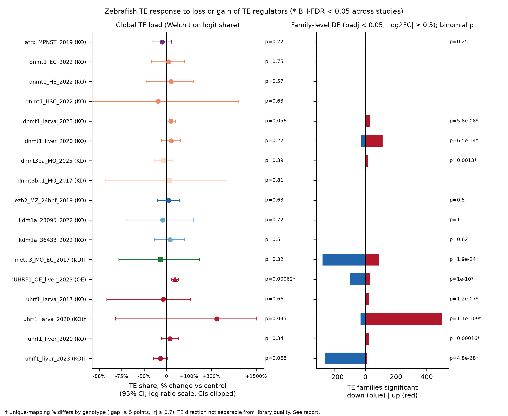
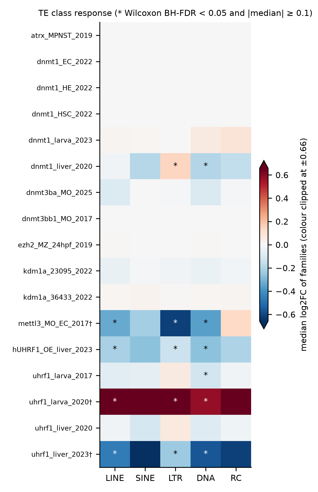
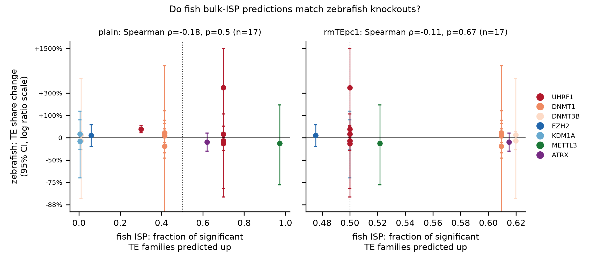

# TE response to genetic loss or gain of TE regulators in zebrafish

*Danio rerio*, 17 contrasts from 14 GEO series, 112 bulk RNA-seq runs ·
`scripts/08_zebrafish_validation.py` · study panel in
`config/zebrafish_perturbation_studies.tsv` · run 2026-10-01 to 2026-10-02 (CPU)

Status. Prespecified: the per-study TE-share test, the per-study family up-vs-down test
(padj < 0.05, |log2FC| >= 0.5, binomial), the shift rule (BH-FDR < 0.05 and >= 5%), and the
two cross-study concordance tests on shifted studies (silencer loss → TE up for every KO/KD
contrast; the 05c fish direction). All are in `scripts/08_zebrafish_validation.py` at commit
`bd7086c` (2026-10-01 10:05 UTC), before any count table existed (the first was written
about 14:10 UTC); DC-14 records only the shift rule. Deviation: clutch blocking
(`~ block + role`) was committed at 16:14 UTC (`665fe99`) after an interim look at two
counted studies and applied to all three clutch-paired studies (DC-19); section 7 shows the
planned `~ role` result beside it. Exploratory: the cross-study concordance on family-level
leans, the library-QC flag (section 6), the mapping-rate covariate (DC-18) and the TE-share
decomposition. Descriptive: class medians and the perturbed-gene check. This is the external
ground truth for the bulk ISP regulator predictions from the *A. polyacanthus* cohort
([`../2026-10-01_fish_bulk_isp/`](../2026-10-01_fish_bulk_isp/)). It asks whether knocking out,
knocking down or overexpressing a TE regulator in zebrafish moves TE expression, and whether
the direction matches (a) the expectation that losing a silencer derepresses TEs, and (b) the
direction 05c predicted for the matching fish regulator.

Standard (ISP-STD-1 v1.1). This report measures ground truth; it runs no ISP itself, so most
of the standard applies to the upstream 05c run, which failed its matched-control test
(B1). Met here: tests and sidedness (exact two-sided binomial vs 0.5) fixed in code before any
output (A1, partly; registered in a commit, not an append-only plan); studies, not libraries,
are the unit (B5 analogue); opposite-direction results are not counted as agreement (B6); reproduce
commands and tool versions are given (E). Not met: no attainability or power check before the
run (A2, C3). Positive controls (C2): dnmt1 and uhrf1 loss are the expected positives; at the
TE-share level none responded, which limits what the null can show. Not applicable: matched
controls, delete/overexpress pairing, no-op, circular-gene and stability gates (B1 to B4,
B7, B8), which
concern the ISP model.

## Abstract

No knockout or knockdown study changed the global TE share of reads at BH-FDR < 0.05 (0 of 16).
The only study that did was the human UHRF1 overexpression in larval liver, where TE share rose
by 29.9% [95% CI 16.6, 44.5] (p = 0.00062, FDR 0.011). The rise is mostly compositional:
gene-assigned reads fell by a quarter (10.27 to 7.73 million per library, difference -2.55
[-4.98, -0.11], p = 0.043) while TE-assigned reads did not change (1.29 vs 1.33 million, p =
0.86), against 14% fewer input reads in the transgenic arm (p = 0.16). TE families in the same
study leaned down (29 up / 102 down). With no loss-of-function study shifted, the prespecified
concordance test against the silencer-loss expectation has no testable studies, and the test
against the fish bulk-ISP direction has one (0 of 1 agree; Clopper-Pearson 95% CI 0 to 0.975).

The per-study family test (prespecified) found a significant lean in 9 of 17 studies
(binomial FDR < 0.05). Pooling those leans across studies is exploratory. Among
loss-of-function contrasts as configured (every KO/KD), 6 of 8 with a lean leaned up (0.75
[0.35, 0.97], p = 0.29; 8 GEO series). Restricted to DNA-methylation regulators (dnmt1, uhrf1,
dnmt3), 6 of 7 leaned up (0.86 [0.42, 1.00], p = 0.13); the mettl3 morphant, an m6A RNA
methyltransferase, leaned down. Three studies carry a genotype-linked difference in library
mapping rate (|gap| >= 5 points, |r| >= 0.7): uhrf1 liver 2023, uhrf1 larva 2020 and the mettl3
morphant. Their TE direction cannot be separated from library quality. In uhrf1 liver 2023 the
downward lean (8 / 266) disappears once mapping rate enters the model (7 / 9; post hoc). Clutch
blocking, added after an interim look, created one of the six upward leans (uhrf1 liver 2020:
0 / 0 under the planned `~ role`, 22 / 3 blocked).

The fish bulk-ISP directions do not track the zebrafish responses. Spearman correlation of
the predicted fraction of TE families up with the observed TE-share change was -0.18 (p =
0.50, n = 17) for the plain run and -0.11 (p = 0.67) after removing the TE axis. On the
family-level leans, the plain predictions agreed in 4 of 9 studies (p = 1.0). The 05c
predictions were themselves no better than expression-matched random genes (empirical p
0.15 to 0.98 in the plain run and 0.055 to 0.89 with the TE axis removed).

## Methods

**Study panel.** A GEO query for zebrafish RNA-seq naming the configured TE regulators,
followed by hand curation, gave 17 contrasts from 14 GEO series and 112 runs. To qualify, a
study needed a genetic loss or gain (or a morpholino knockdown), bulk RNA-seq, and replicated
arms. Single-cell, drug-only, methylation-only and unreplicated studies were excluded
(GSE103913, GSE93927). Every contrast is perturbed against its own study's controls, and
studies are analysed separately, never pooled. Counts below give both units: 17 contrasts
and 14 distinct GEO series.

| Study | GEO | Target | Material | Perturbed vs control | Layout | Clutch-blocked |
|---|---|---|---|---|---|---|
| `ZF_uhrf1_larva_2020` | GSE160708 | uhrf1 KO | whole larvae 5 dpf | 2 vs 2 | paired |  |
| `ZF_uhrf1_liver_2020` | GSE160710 | uhrf1 KO | larval liver 5 dpf | 5 vs 5 | paired | yes |
| `ZF_uhrf1_liver_2023` | GSE234993 | uhrf1 KO | larval liver 5 dpf (DMSO arm) | 5 vs 4 | paired | yes |
| `ZF_uhrf1_larva_2017` | GSE91024 | uhrf1 KO | whole larvae 5 dpf | 2 vs 2 | single |  |
| `ZF_dnmt1_liver_2020` | GSE160726 | dnmt1 KO | larval liver 5 dpf | 3 vs 3 | paired |  |
| `ZF_dnmt1_larva_2023` | GSE181571 | dnmt1 KO (hypomorph) | larvae, *pole1* WT | 4 vs 4 | paired |  |
| `ZF_dnmt1_EC_2022` | GSE189072 | dnmt1 KO | sorted endothelial cells | 3 vs 3 | paired |  |
| `ZF_dnmt1_HE_2022` | GSE189072 | dnmt1 KO | sorted haemogenic endothelium | 3 vs 3 | paired |  |
| `ZF_dnmt1_HSC_2022` | GSE189072 | dnmt1 KO | sorted HSC | 2 vs 2 | paired |  |
| `ZF_ezh2_MZ_24hpf_2019` | GSE119070 | ezh2 KO (maternal-zygotic) | embryos 24 hpf | 7 vs 6 | mixed paired/single |  |
| `ZF_kdm1a_23095_2022` | GSE198476 | kdm1a KO, allele 23095 | tail 24 hpf | 3 vs 2 | paired |  |
| `ZF_kdm1a_36433_2022` | GSE198476 | kdm1a KO, allele 36433 | tail 24 hpf | 3 vs 3 | paired |  |
| `ZF_dnmt3bb1_MO_2017` | GSE74929 | dnmt3bb.1 morpholino | sorted HSC 48 hpf | 2 vs 2 | paired |  |
| `ZF_dnmt3ba_MO_2025` | GSE263295 | dnmt3ba morpholino | embryos | 3 vs 3 | paired |  |
| `ZF_mettl3_MO_EC_2017` | GSE89655 | mettl3 morpholino | endothelial cells | 2 vs 2 | paired |  |
| `ZF_atrx_MPNST_2019` | GSE125040 | atrx KO | MPNST tumours, *tp53* mutant background | 3 vs 3 | paired |  |
| `ZF_hUHRF1_OE_liver_2023` | GSE227735 | human UHRF1 overexpression | larval liver 5 dpf | 5 vs 6 | paired | yes |

**References and quantification.** Reads were mapped to Ensembl GRCz11 release 112 (primary
assembly and GTF, MD5-checked against Ensembl CHECKSUMS). TE loci come from UCSC danRer11
RepeatMasker (`make_te_gtf.py`): 3,562,104 loci in 11,255 subfamilies, with alt-haplotype loci
dropped and `chrUn_*vN` mapped to Ensembl `*.N`. Each run went through the TE_Ocean_Acidification
pipeline: fastp, STAR 2.7.11b, and TEcount 2.2.4 in `--mode multi`, which distributes
multi-mapping reads. Counting is unstranded for every study.

**Deviation from the plan.** Clutch blocking was not in the original design. It was added after
an interim look showed that uhrf1 liver gave 3 DE genes under `~ role`, and it was applied to all
three clutch-paired studies, not only the one that prompted it.

**Differential expression.** DESeq2 1.46.0 with apeglm 1.28.0 log2 fold-change shrinkage, run
in the frozen environment of the OA study. The design is `~ role` (perturbed vs control),
except for the three clutch-paired studies (`ZF_uhrf1_liver_2020`, `ZF_uhrf1_liver_2023`,
`ZF_hUHRF1_OE_liver_2023`). There each mutant or transgenic sample is paired with a sibling
control from the same clutch, and the design is `~ block + role`.

**Per-study statistics (08).**
- *TE families.* Families in strict TE classes with baseMean >= 10 are tested. A family is
  called up or down at padj < 0.05 and |log2FC| >= 0.5. We report the fraction called up, its
  exact binomial 95% CI, and the binomial test of up vs down, with BH-FDR across studies.
- *Median family log2FC,* with a bootstrap 95% CI over families and a Wilcoxon signed-rank p.
  Families are not independent, so this is descriptive.
- *TE classes.* Median log2FC and Wilcoxon p per class, with BH-FDR across all study × class tests.
- *Global TE share of counted reads,* per library. Perturbed and control arms are compared on
  the logit scale (Welch t, 95% CI) and back-transformed to a relative change in %. BH-FDR is
  across studies.
- *Perturbed-gene check.* The targeted gene's own log2FC (see Limitations for the alleles and
  designs where this check cannot work).

**Across studies.** A study counts as shifted when its TE share changes at BH-FDR < 0.05 and by
at least 5%. For shifted studies we test agreement with (a) the expectation that losing a
silencer derepresses TEs and (b) the direction predicted by `05_bulk_linear_isp.py` for the
matching fish regulator (fraction of significant TE families up, in both the plain and the
TE-axis-removed runs). Each test is an exact binomial test against 0.5. The fraction agreeing
carries a Clopper-Pearson 95% CI, and BH-FDR runs across the prediction rows.

**Sensitivity: GSE234993 read 1 only.** GSE234993 (`ZF_uhrf1_liver_2023`) maps poorly. Mutants
map 20.9% uniquely and controls 28.1% (interim check, n = 5 vs 3; Welch p = 0.11, Mann-Whitney
p = 0.071; final values with all four controls in section 5). The gap coincides with a higher
"too short" fraction after adapter trimming in mutants (58.7% vs 47.3%, Welch p = 0.037;
`08c_qc_by_arm.tsv`), although dropping read 2 does not close it (section 5). The study was
therefore realigned single-end from read 1 with the same reference and tool versions, on a
different host (aarch64 build of the same versions), and DESeq2 was rerun with the same
clutch-blocked design. Both results are reported (DC-16, DC-17). The paired-end result is
primary. If the read-1-only result changes the direction of the TE response or its BH
significance, the study is reported as not robust to the mapping artefact.

**Post hoc: mapping rate as a covariate (DC-18, added 2026-10-01 19:15 UTC after the gap was
seen).** With all nine libraries aligned the gap held in both alignments, so DESeq2 was rerun
with the centred, scaled unique-mapping % as a covariate (`scripts/04b_bulk_te_deseq_mapcov.R`),
in two designs: `~ block + uniq + role` (2 residual degrees of freedom) and `~ uniq + role`.
Mapping rate and genotype are correlated (point-biserial r = -0.77, p = 0.014), so the
adjustment also removes any true genotype effect that tracks mapping quality. This analysis
was not in the plan and is labelled post hoc wherever it appears.

## Results

### 1. Does losing or gaining a regulator move TE expression within each study?

Families are called at padj < 0.05 and |log2FC| >= 0.5. Fraction up has an exact binomial
95% CI; TE share is the TE fraction of counted reads (logit-scale Welch t, back-transformed).
FDR is BH across the 17 studies for each test.

| Study | n P/C | Families tested | Up / down | Fraction up [95% CI] | p (FDR) | Median log2FC [95% CI] | TE share C → P (%) | Change [95% CI] | p (FDR) |
|---|---|---|---|---|---|---|---|---|---|
| atrx MPNST 2019 | 3/3 | 899 | 3 / 0 | 1.00 [0.29, 1.00] | 0.25 (0.32) | -0.001 [-0.001, 0.000] | 6.99 → 6.12 | -12.5% [-34.2, +15.8] | 0.22 (0.61) |
| dnmt1 EC 2022 | 3/3 | 903 | 0 / 0 | – | – | 0.000 [0.000, 0.000] | 15.34 → 16.34 | +6.5% [-37.8, +73.0] | 0.75 (0.80) |
| dnmt1 HE 2022 | 3/3 | 903 | 0 / 0 | – | – | 0.000 [0.000, 0.000] | 10.88 → 12.55 | +15.4% [-46.8, +130.9] | 0.57 (0.80) |
| dnmt1 HSC 2022 | 2/2 | 890 | 0 / 0 | – | – | 0.000 [0.000, 0.000] | 9.69 → 7.46 | -23.0% [-99.3, +837.9] | 0.63 (0.80) |
| dnmt1 larva 2023 | 4/4 | 965 | 29 / 1 | 0.97 [0.83, 1.00] | 5.8e-08 (1.3e-07) | +0.015 [+0.012, +0.019] | 8.02 → 9.19 | +14.6% [-0.5, +31.8] | 0.056 (0.39) |
| dnmt1 liver 2020 | 3/3 | 974 | 112 / 26 | 0.81 [0.74, 0.87] | 6.5e-14 (2.1e-13) | -0.101 [-0.119, -0.084] | 11.87 → 13.77 | +16.0% [-14.9, +55.8] | 0.22 (0.61) |
| dnmt3ba MO 2025 | 3/3 | 933 | 16 / 2 | 0.89 [0.65, 0.99] | 0.0013 (0.0019) | -0.059 [-0.067, -0.048] | 3.80 → 3.45 | -9.2% [-31.6, +20.1] | 0.39 (0.73) |
| dnmt3bb1 MO 2017 | 2/2 | 821 | 0 / 0 | – | – | 0.000 [0.000, 0.000] | 4.39 → 4.80 | +9.3% [-84.9, +528.8] | 0.81 (0.81) |
| ezh2 MZ 24 hpf 2019 | 7/6 | 978 | 0 / 2 | 0.00 [0.00, 0.84] | 0.50 (0.59) | +0.005 [+0.004, +0.005] | 13.25 → 14.24 | +7.5% [-24.0, +49.1] | 0.63 (0.80) |
| hUHRF1 OE liver 2023 | 5/6 | 916 | 29 / 102 | 0.22 [0.15, 0.30] | 1.0e-10 (2.6e-10) | -0.231 [-0.245, -0.219] | 10.76 → 13.98 | **+29.9% [+16.6, +44.5]** | **0.00062 (0.011)** |
| kdm1a 23095 2022 | 3/2 | 985 | 5 / 5 | 0.50 [0.19, 0.81] | 1.0 (1.0) | -0.036 [-0.039, -0.032] | 15.78 → 14.06 | -10.9% [-71.3, +128.6] | 0.72 (0.80) |
| kdm1a 36433 2022 | 3/3 | 982 | 3 / 1 | 0.75 [0.19, 0.99] | 0.62 (0.68) | +0.013 [+0.012, +0.013] | 13.80 → 15.45 | +11.9% [-30.5, +73.4] | 0.50 (0.80) |
| mettl3 MO EC 2017 † | 2/2 | 700 | 88 / 280 | 0.24 [0.20, 0.29] | 1.9e-24 (8.3e-24) | -0.407 [-0.469, -0.334] | 5.91 → 4.94 | -16.5% [-76.9, +176.3] | 0.32 (0.71) |
| uhrf1 larva 2017 | 2/2 | 998 | 24 / 0 | 1.00 [0.86, 1.00] | 1.2e-07 (2.2e-07) | -0.051 [-0.062, -0.040] | 39.53 → 35.83 | -9.4% [-84.2, +108.3] | 0.66 (0.80) |
| uhrf1 larva 2020 † | 2/2 | 993 | 502 / 32 | 0.94 [0.92, 0.96] | 1.1e-109 (1.4e-108) | +0.720 [+0.685, +0.763] | 5.76 → 27.33 | +374.6% [-79.3, +1500.2] | 0.095 (0.40) |
| uhrf1 liver 2020 | 5/5 | 909 | 22 / 3 | 0.88 [0.69, 0.97] | 0.00016 (0.00025) | -0.045 [-0.054, -0.031] | 10.05 → 11.21 | +11.6% [-14.1, +43.6] | 0.34 (0.71) |
| uhrf1 liver 2023 † | 5/4 | 729 | 8 / 266 | 0.03 [0.01, 0.06] | 4.8e-68 (3.1e-67) | -0.506 [-0.537, -0.483] | 3.80 → 3.15 | -16.9% [-32.4, +2.0] | 0.068 (0.39) |

† Unique-mapping % differs by genotype (|gap| >= 5 points and |r| >= 0.7; section 6). The TE
direction in these studies cannot be separated from library quality.



*Figure 1. Left: relative change in TE share of counted reads, perturbed vs control, with 95%
CI on a log ratio axis (CIs beyond the axis are clipped). p is the Welch test on the logit
share; * marks BH-FDR < 0.05 across studies. Right: TE families called up (red) and down
(blue); p is the binomial test of up vs down.*

Global TE share moved significantly in one study, the hUHRF1 overexpression. The TE share and
the family-level result in that study disagree (share up by 29.9%, families 29 up / 102 down,
every class median down). Read totals per library
(`tables/08d_hUHRF1_OE_te_share_contributors_read_totals.tsv`) show where the share change
comes from. The transgenic arm had fewer input reads (12.30 vs 14.28 million, Welch p = 0.16)
and fewer uniquely mapped reads (9.88 vs 12.31 million, p = 0.11). Gene-assigned reads fell
most (7.73 vs 10.27 million, p = 0.043), while TE-assigned reads did not change (1.33 vs 1.29
million, p = 0.86). All pairs are transgenic vs control. The share gain is spread thinly over
905 of 1,020 families, with the top ten carrying 20.5% of it
(`tables/08d_hUHRF1_OE_te_share_contributors.tsv`). The share rose mainly because fewer reads
were assigned to genes. Per input read, TE-assigned reads were about 20% higher in the
transgenic arm; with lower depth and lower mapping in that arm we cannot tell whether this
reflects more TE transcripts or a shift in which reads map, and the size-factor-normalised
family test points the other way. Mapping rate in this study is also lower in the transgenic
arm (79.5% vs 86.2% unique, p = 0.055, r = -0.68), just below the flag threshold. For context
only, since it was not a registered test: hUHRF1 overexpression in zebrafish liver is reported
to cause DNA hypomethylation through Dnmt1 destabilisation (Mudbhary et al., Cancer Cell 2014),
which would predict TE derepression. Neither readout here shows TE reads rising.

No loss-of-function study reached FDR < 0.05 for TE share. The largest point estimate, uhrf1
larva 2020 (+375%), has 2 libraries per arm and a CI from -79% to +1,500%. dnmt1 larva 2023
came closest among the better-replicated studies (+14.6% [-0.5, +31.8], p = 0.056, FDR 0.39).

Nine studies show a significant family-level lean (prespecified per-study test). The lean was
upward in dnmt1 liver and larva, dnmt3ba morphants and three of four uhrf1 knockouts. In dnmt1
liver the response was class-specific: LTR families rose (median log2FC +0.14, 89% of
significant LTR families up, Wilcoxon FDR < 1e-4) while DNA transposons fell (median -0.19),
so the study-wide median is slightly negative. uhrf1 larva 2020 shows the strongest and most
uniform derepression (502 up vs 32 down; median log2FC +0.72 [+0.69, +0.76], every class up),
but its mutant libraries map 15 points better and carry fewer duplicates than its controls
(section 6), so we do not treat its size as a clean estimate. The mettl3 morphant (also †)
and the hUHRF1 overexpression leaned down.

### 2. Which TE classes respond?



*Figure 2. Median log2FC of TE families per class and study (colour clipped at ±0.66);
* marks Wilcoxon BH-FDR < 0.05 (BH across the 51 tested study × class cells) and |median|
>= 0.1. RC and SINE have 6 to 8 families and are not tested.*

Of 51 tested study × class cells (LINE, LTR and DNA in 17 studies), 43 pass FDR < 0.05, and 15
of those 43 have a median within ±0.01 of zero, because a Wilcoxon test over several hundred
apeglm-shrunken families detects very small shifts, so the figure stars only cells with
|median| >= 0.1. The full test results are in `tables/08_class_te_response.tsv`. The clear
class-level responses are uhrf1 larva 2020 (†; all classes up, LTR median +0.98), dnmt1 liver
(LTR +0.14, DNA -0.19), mettl3 morphants (†; all tested classes down, LTR -0.61), hUHRF1
overexpression (all down, -0.14 to -0.27; see section 1 on its TE share) and uhrf1 liver 2023
(†; tested classes down, -0.24 to -0.56).

### 3. Did the perturbation hit its target?

| Study | Gene | log2FC | padj | Expect a fall? |
|---|---|---|---|---|
| kdm1a 36433 2022 | kdm1a | -2.06 | 5.2e-42 | yes; falls |
| ezh2 MZ 24 hpf 2019 | ezh2 | -1.11 | 0.012 | yes; falls |
| dnmt3ba MO 2025 | dnmt3bb.1 / dnmt3bb.2 / dnmt3ba | -0.68 / -0.79 / -0.01 | 0.028 / 0.10 / 0.98 | no (morpholino) |
| uhrf1 larva 2020 | uhrf1 | -0.92 | 0.12 | allele-dependent |
| dnmt1 liver 2020 | dnmt1 | -0.31 | 0.39 | no (s904 point mutant) |
| kdm1a 23095 2022 | kdm1a | +0.06 | 0.87 | allele-dependent |
| uhrf1 liver 2020, 2023; larva 2017 | uhrf1 | +0.12, +0.18, -0.04 | 0.72, 0.73, 0.97 | no (hi272 insertional) |
| atrx MPNST 2019 | atrx | +0.01 | 0.97 | allele-dependent |
| dnmt1 EC, HE, HSC 2022; larva 2023 | dnmt1 | ≈ 0 | > 0.99 | allele-dependent |
| dnmt3bb1 MO 2017 | dnmt3 paralogues | ≈ 0 | > 0.99 | no (morpholino) |
| mettl3 MO EC 2017 | mettl3 | +2.56 | 7.7e-56 | no (morpholino) |
| hUHRF1 OE liver 2023 | zebrafish uhrf1 | +0.75 | 0.0051 | not applicable (human transgene) |

Two alleles show the expected fall of their own mRNA (kdm1a 36433, ezh2 MZ), and neither moved
TEs. For most other studies the check cannot confirm or refute the perturbation (see
Limitations). kdm1a and ezh2 are not DNA-methylation regulators, so this negative is consistent
with TE silencing in zebrafish embryos and larvae resting mainly on DNA methylation; the panel
cannot show that. The rise of *mettl3* in its morphants (+2.56) fits a splice-blocking
morpholino that retains intronic reads or a compensatory response; it does not show the
knockdown failed. The rise of zebrafish *uhrf1* in the hUHRF1 line may be cross-mapping of the
human transcript or feedback; we did not test which.

### 4. Do the shifts agree with the predictions?

**Prespecified tests** (unit: a study whose TE share shifts at FDR < 0.05 and by >= 5%):

| Prediction | Studies shifted | Agree | Fraction [95% CI] | p (vs 0.5) | FDR |
|---|---|---|---|---|---|
| Silencer loss → TE up (KO/KD only) | 0 of 16 | – | – | – | – |
| Fish bulk ISP, plain | 1 of 17 | 0 | 0.00 [0.00, 0.975] | 1.0 | 1.0 |
| Fish bulk ISP, TE axis removed | 0 of 17 (the one shifted study has no rmTEpc1 call) | – | – | – | – |

**Exploratory tests on the family-level lean** (unit: a study with binomial FDR < 0.05;
defined after the prespecified tests turned out near-empty). The silencer set is shown as
configured (every KO/KD) and split into DNA-methylation regulators (dnmt1, uhrf1, dnmt3) and
the m6A writer mettl3. "Planned design" uses `~ role` for the three clutch-paired studies
(section 7); "primary design" uses `~ block + role`.

| Prediction | Design | Studies | Agree | Fraction [95% CI] | p (vs 0.5) | FDR (8 rows) |
|---|---|---|---|---|---|---|
| Silencer loss → TE up, as configured (KO/KD) | primary | 8 | 6 | 0.75 [0.35, 0.97] | 0.29 | 0.46 |
| same | planned | 7 | 5 | 0.71 [0.29, 0.96] | 0.45 | 0.60 |
| DNA-methylation loss → TE up | primary | 7 | 6 | 0.86 [0.42, 1.00] | 0.13 | 0.33 |
| same | planned | 6 | 5 | 0.83 [0.36, 1.00] | 0.22 | 0.44 |
| DNA-methylation loss, without † studies | primary | 5 | 5 | 1.00 [0.48, 1.00] | 0.063 | 0.33 |
| same | planned | 4 | 4 | 1.00 [0.40, 1.00] | 0.13 | 0.33 |
| mettl3 loss → TE up | either | 1 | 0 | – | – | – |
| Fish bulk ISP, plain | primary | 9 | 4 | 0.44 [0.14, 0.79] | 1.0 | 1.0 |
| Fish bulk ISP, TE axis removed | primary | 4 | 3 | 0.75 [0.19, 0.99] | 0.63 | 0.71 |

The † exclusion drops one study on each side (uhrf1 liver 2023 down, uhrf1 larva 2020 up) and
mettl3 is outside the DNA-methylation set, so no row depends on excluding only the study that
disagrees. Each DNA-methylation row comes from distinct GEO series. The rows and both
Spearman values are in `tables/08f_exploratory_concordance.tsv`; no row passes FDR < 0.05.



*Figure 3. Fish bulk-ISP prediction (fraction of significant TE families predicted up for the
matching regulator) against the zebrafish TE-share change with 95% CI, log ratio axis.
Spearman ρ = -0.18 (p = 0.50) plain and -0.11 (p = 0.67) with the TE axis removed; n = 17.*

The prespecified tests are close to empty: the TE share moved in one study, and that study is
an overexpression whose share change is mostly compositional. On the exploratory
family-level unit, loss of a DNA-methylation regulator leaned toward derepression in 6 of 7
studies (p = 0.13), and in every study without a genotype-linked mapping gap (5 of 5,
p = 0.063). None of these reaches p < 0.05 at this number of studies. The fish predictions
agreed at chance level (4 of 9, p = 1.0). Several zebrafish studies
share one fish prediction (four uhrf1 studies, five dnmt1 studies), so the number of
independent regulator-level tests is smaller than the study counts suggest.

### 5. Sensitivity: GSE234993 read 1 only

Unique mapping per library (STAR "Uniquely mapped reads %"):

| Alignment | Mutant mean (n = 5) | Control mean (n = 4) | Difference [95% CI] | p Welch | p Mann-Whitney | r (genotype, mapping) |
|---|---|---|---|---|---|---|
| Paired | 20.9% | 27.5% | -6.5 [-12.9, -0.2] | 0.046 | 0.032 | -0.77 (p = 0.014) |
| Read 1 only | 20.6% | 26.9% | -6.3 [-12.6, -0.02] | 0.050 | 0.032 | -0.77 (p = 0.016) |

TE families (08 rules: strict TE classes, baseMean >= 10, padj < 0.05 and |log2FC| >= 0.5),
six DESeq2 runs of this study. Status messages on 2026-10-01/02 quoted looser counts (every
repeat feature including Satellite, Simple_repeat and Unknown, padj < 0.05 only; for example
11 / 285 for the primary run). Those should not be quoted; the values below are the record.

| Alignment | Design | Up / down | Fraction up [95% CI] | p binomial | FDR (6 runs) | Median TE log2FC | Genes padj < 0.05 |
|---|---|---|---|---|---|---|---|
| Paired | `~ block + role` (primary) | 8 / 266 | 0.03 [0.01, 0.06] | 4.8e-68 | 1.4e-67 | -0.51 | 1,315 |
| Paired | `~ block + uniq + role` (post hoc) | 7 / 9 | 0.44 [0.20, 0.70] | 0.80 | 0.80 | -0.05 | 370 |
| Paired | `~ uniq + role` (post hoc) | 11 / 46 | 0.19 [0.10, 0.32] | 3.3e-06 | 6.6e-06 | -0.12 | 812 |
| Read 1 only | `~ block + role` | 9 / 275 | 0.03 [0.01, 0.06] | 1.9e-69 | 1.2e-68 | -0.50 | 1,317 |
| Read 1 only | `~ block + uniq + role` (post hoc) | 6 / 10 | 0.38 [0.15, 0.65] | 0.45 | 0.55 | -0.05 | 367 |
| Read 1 only | `~ uniq + role` (post hoc) | 13 / 49 | 0.21 [0.12, 0.33] | 4.8e-06 | 7.2e-06 | -0.13 | 841 |

The paired and read-1-only runs agree closely, so the study passes the DC-16 rule: dropping
read 2 and changing the CPU build change neither the direction nor the BH significance. The
flag on this study rests on the post hoc DC-18 analysis and the QC comparison in section 6.
Dropping read 2 did not close the mapping gap, so the "too short after trimming" explanation
does not account for it. Adding mapping rate to the model removes most of the downward lean:
with clutch and mapping both in the model the lean disappears (7 / 9), and with mapping alone a
weaker downward lean remains (11 / 46). With r = -0.77 between genotype and mapping rate and
two residual degrees of freedom, these models cannot separate a true uhrf1 effect from a
library-quality effect. The mapping gap is -6.5 points [-12.9, -0.2]; its p values (0.046
Welch, 0.032 Mann-Whitney, n = 5 vs 4) sit near the boundary, and the flag rests on the size of
the gap and its correlation with genotype, not on crossing 0.05. We make no TE-direction claim
for this study.

### 6. Library QC by arm, all studies

Unique-mapping % (STAR) and duplication % (fastp) per arm for every contrast
(`tables/08c_qc_by_arm.tsv`, per run in `08c_qc_per_run.tsv`). Difference is perturbed minus
control in percentage points, Welch 95% CI and p, BH-FDR across 17 studies; r is the
point-biserial correlation of genotype with unique-mapping %. A study is flagged (†) when the
gap is at least 5 points and |r| >= 0.7, the pattern GSE234993 showed. The threshold was set
from that study, so the flag is post hoc.

| Study | Unique % P / C | Difference [95% CI] | p (FDR) | r | Duplication % P / C | p (FDR) | Flag |
|---|---|---|---|---|---|---|---|
| atrx MPNST 2019 | 92.5 / 92.5 | +0.0 [-1.2, +1.2] | 0.95 (1.0) | 0.03 | 13.2 / 9.4 | 0.19 (0.69) | |
| dnmt1 EC 2022 | 65.1 / 65.6 | -0.5 [-16.9, +15.8] | 0.93 (1.0) | -0.05 | 9.3 / 13.1 | 0.084 (0.60) | |
| dnmt1 HE 2022 | 65.0 / 66.8 | -1.8 [-17.2, +13.6] | 0.75 (1.0) | -0.17 | 11.6 / 12.7 | 0.52 (0.80) | |
| dnmt1 HSC 2022 | 60.1 / 62.9 | -2.8 [-65.6, +60.1] | 0.85 (1.0) | -0.15 | 14.3 / 13.7 | 0.83 (0.89) | |
| dnmt1 larva 2023 | 91.9 / 92.0 | -0.1 [-0.7, +0.5] | 0.65 (1.0) | -0.20 | 80.0 / 75.5 | 0.26 (0.75) | |
| dnmt1 liver 2020 | 86.2 / 86.2 | +0.0 [-5.6, +5.6] | 1.0 (1.0) | 0.00 | 21.3 / 24.2 | 0.20 (0.69) | |
| dnmt3ba MO 2025 | 96.0 / 95.3 | +0.7 [-0.2, +1.6] | 0.077 (0.33) | 0.85 | 16.0 / 14.6 | 0.41 (0.77) | |
| dnmt3bb1 MO 2017 | 95.5 / 94.8 | +0.7 [-13.4, +14.9] | 0.75 (1.0) | 0.27 | 38.2 / 39.1 | 0.97 (0.97) | |
| ezh2 MZ 24 hpf 2019 | 74.2 / 73.6 | +0.6 [-9.2, +10.4] | 0.89 (1.0) | 0.04 | 33.4 / 41.6 | 0.40 (0.77) | |
| hUHRF1 OE liver 2023 | 79.5 / 86.2 | -6.7 [-13.6, +0.2] | 0.055 (0.31) | -0.68 | 11.8 / 14.2 | 0.62 (0.80) | near |
| kdm1a 23095 2022 | 75.3 / 81.7 | -6.4 [-51.2, +38.4] | 0.61 (1.0) | -0.26 | 30.3 / 26.6 | 0.71 (0.80) | |
| kdm1a 36433 2022 | 85.0 / 83.8 | +1.3 [-8.0, +10.5] | 0.66 (1.0) | 0.24 | 22.5 / 23.9 | 0.63 (0.80) | |
| mettl3 MO EC 2017 | 77.6 / 84.8 | -7.2 [-10.0, -4.4] | 0.018 (0.30) | -1.00 | 1.3 / 1.5 | 0.046 (0.60) | † |
| uhrf1 larva 2017 | 65.4 / 83.5 | -18.1 [-257.9, +221.7] | 0.55 (1.0) | -0.51 | 26.8 / 18.9 | 0.50 (0.80) | |
| uhrf1 larva 2020 | 89.7 / 74.7 | +15.0 [-91.4, +121.3] | 0.33 (0.92) | 0.78 | 14.3 / 41.6 | 0.11 (0.60) | † |
| uhrf1 liver 2020 | 75.8 / 82.6 | -6.8 [-21.6, +7.9] | 0.29 (0.92) | -0.39 | 8.8 / 9.9 | 0.34 (0.77) | |
| uhrf1 liver 2023 | 20.9 / 27.5 | -6.5 [-12.9, -0.2] | 0.046 (0.31) | -0.77 | 40.0 / 39.6 | 0.68 (0.80) | † |

No mapping gap passes FDR < 0.05, so these are flags, not findings. Three studies match the
GSE234993 pattern. In uhrf1 larva 2020 the mutants map better and are less duplicated (14% vs
42%). Differential mapping and duplication can change which reads, multi-mappers included, land
on TE families relative to genes; DESeq2 size factors correct depth, not that. In the mettl3
morphant, genotype and mapping rate are almost perfectly confounded (r = -1.00). With 2
libraries per arm a mapping covariate cannot be fitted alongside genotype in either study, so
they carry the same label as GSE234993 without the adjustment. uhrf1 larva 2017 (-18 points)
and hUHRF1 OE (-6.7, r = -0.68) have large gaps that fall short of the rule.

### 7. The clutch-blocking deviation

Clutch blocking was added after the interim look (DC-19). Planned `~ role` against primary
`~ block + role` for the three clutch-paired studies, 08 family rules
(`tables/08e_clutch_deviation.tsv`):

| Study | Design | Up / down | Fraction up [95% CI] | p binomial | FDR (6 rows) | Genes padj < 0.05 |
|---|---|---|---|---|---|---|
| uhrf1 liver 2020 | `~ block + role` | 22 / 3 | 0.88 [0.69, 0.97] | 0.00016 | 0.00019 | 1,484 |
| uhrf1 liver 2020 | `~ role` (planned) | 0 / 0 | – | – | – | 3 |
| uhrf1 liver 2023 | `~ block + role` | 8 / 266 | 0.03 [0.01, 0.06] | 4.8e-68 | 1.4e-67 | 1,315 |
| uhrf1 liver 2023 | `~ role` (planned) | 16 / 453 | 0.03 [0.02, 0.05] | 2.7e-112 | 1.6e-111 | 2,557 |
| hUHRF1 OE liver 2023 | `~ block + role` | 29 / 102 | 0.22 [0.15, 0.30] | 1.0e-10 | 2.0e-10 | 5,126 |
| hUHRF1 OE liver 2023 | `~ role` (planned) | 33 / 94 | 0.26 [0.19, 0.35] | 5.7e-08 | 8.5e-08 | 5,548 |

The deviation changed one call: uhrf1 liver 2020 has a significant upward lean only with clutch
blocking. The other two studies keep their direction under either design. In the interim look
the mutant TE share was higher than its sibling's in 4 of 5 clutches (recorded in
`RUN_RECORD.md`, entry "16:15 UTC"), which is why pairing was added; the blocked model matches
the study's design, but it was chosen after looking. Section 4 reports the concordance counts
under both designs.

## Interpretation

1. Global TE load is a blunt readout in these studies. With 2 to 5 libraries per arm, TE share
   has CIs that span tens of percent, and no loss-of-function study moved it at FDR < 0.05. A
   null here does not mean TEs were unaffected; uhrf1 larva 2020 shows a +375% point estimate
   with a CI that crosses zero.
2. Family-level responses lean toward derepression after loss of DNA-methylation regulators.
   Across all loss-of-function studies as configured, 6 of 8 with a lean leaned up
   (exploratory; 0.75 [0.35, 0.97], p = 0.29). Among DNA-methylation regulators, six of seven
   such studies with a lean leaned up (0.86 [0.42, 1.00], p = 0.13), five of five among studies
   without a genotype-linked mapping gap (p = 0.063), and five of six under the planned design
   (p = 0.22). The direction is consistent; the evidence is weak because there are few studies
   and two leans (uhrf1 larva 2020 up, uhrf1 liver 2023 down) coincide with library-quality
   differences. In dnmt1 liver the gain is in LTR families. Not every allele or tissue
   responds: the sorted dnmt1 cell studies (2 to 3 per arm) show almost no differential
   expression at all. The mettl3 morphant, an RNA rather than DNA methylation regulator, leaned
   down, and kdm1a, ezh2 and atrx did not move TEs, including the two alleles whose own mRNA
   fell.
3. The fish bulk-ISP directions are not supported. They do not correlate with the zebrafish
   TE-share changes and agree with the family-level leans at chance. This matches the 05c
   result that the fish regulator calls are indistinguishable from expression-matched random
   genes. The test has low power: the step crosses species, tissue and perturbation type (CO2
   exposure to knockout), so a null here only weakly disconfirms the predictions.
4. A direct test would need better-replicated loss-of-function studies (5 or more per arm) of
   the same regulators, ideally in a tissue matching the fish data, with stranded libraries and
   mapping QC balanced across arms.

## Limitations

- Small arms. Most contrasts have 2 to 5 libraries per arm, so a null result in one study is
  weak evidence of no response. Each study is analysed alone, with no pooling.
- The perturbed-gene check does not apply everywhere.
  - Morpholinos (dnmt3, mettl3) block translation or splicing and need not lower mRNA.
  - The hUHRF1 transgene is human, so zebrafish *uhrf1* mRNA is not the target.
  - The uhrf1 hi272 (insertional) and dnmt1 s904 (point) alleles do not lower their own mRNA.
    The check is uninformative for them.
- Tissue and background confounds. atrx compares MPNST tumours on a *tp53* mutant background,
  so tumour composition and the background can move TEs. Several studies are whole larvae or
  embryos, where a developmental delay in mutants shifts composition. Sorted-cell studies (EC,
  HE, HSC) have little material per sample.
- Counting. Counting is unstranded for every study, so antisense transcription through a TE
  counts as TE expression. TEcount `--mode multi` distributes multi-mapping reads, so young,
  near-identical subfamilies are less certain than old ones.
- Library layout. `ZF_ezh2_MZ_24hpf_2019` mixes paired-end and single-end libraries within the
  study, balanced across arms (paired 5 perturbed / 4 control, single 2 / 2). DESeq2 has no
  layout covariate. `ZF_uhrf1_larva_2017` is single-end throughout.
- GSE234993 mapping. Only 19 to 32% of reads map uniquely, and about 40% are duplicates in both
  arms (fastp; `08c_qc_by_arm.tsv`). Mutants map 6.5 points lower than controls (p = 0.046
  Welch, 0.032 Mann-Whitney); with read 1 only the gap is 6.3 points (p = 0.050 Welch). The TE
  result for this study does not survive adjustment for mapping rate (post hoc, DC-18). The
  read-1-only realignment ran on an aarch64 host with the same tool versions (STAR 2.7.11b,
  fastp 1.3.6, samtools 1.23.1, TEtranscripts 2.2.4) and the same sha256-checked reference.
- Class-level stars. The Wilcoxon test over hundreds of shrunken log2FC values flags shifts of
  a few hundredths of a log2 unit. Class results are descriptive.
- Exploratory tests. The family-level concordance tests, the QC flag and its threshold, and the
  mapping covariate were defined after the prespecified TE-share tests turned out to have
  almost no testable studies, and after the GSE234993 gap was seen.
- Compositional readout. TE share is a fraction of counted reads; it moves when gene-assigned
  reads change. The one significant share change (hUHRF1 OE) is mostly of this kind.
- Cross-species step. The predictions come from a different species (*A. polyacanthus*), tissue
  and perturbation type (environmental CO2, not a knockout). Agreement or disagreement is
  indirect evidence about the bulk-ISP calls.
- Few independent studies. The concordance tests count studies, and a single GEO series
  (GSE189072) contributes three dnmt1 contrasts. These are not independent.

## Files

| File | Content |
|---|---|
| `tables/08_study_te_response.tsv` | Per study: TE families tested, up/down, fraction up with binomial 95% CI and p, FDR; median family log2FC with bootstrap 95% CI and Wilcoxon p; TE share per arm, relative change with 95% CI, Welch p, FDR |
| `tables/08_class_te_response.tsv` | Per study × TE class: n, median log2FC, fraction of significant families up, Wilcoxon p, FDR |
| `tables/08_family_lfc.tsv.gz` | Every TE family × study: baseMean, log2FC, padj |
| `tables/08_perturbed_gene_check.tsv` | Target gene's own baseMean, log2FC and padj per study |
| `tables/08_prediction_concordance.tsv` | Per prediction: studies with a significant shift, number agreeing, fraction with Clopper-Pearson 95% CI, exact binomial p vs 0.5, BH-FDR |
| `figures/08_fig1` to `08_fig3` (`.png` 300 dpi, `.pdf` vector) | Figures above |
| `tables/08s_gse234993_sensitivity.tsv` | GSE234993: TE families up/down, fraction up with 95% CI, binomial p and BH-FDR for six DESeq2 runs (paired / read 1 only × three designs) |
| `tables/08c_qc_by_arm.tsv`, `08c_qc_per_run.tsv` | Unique-mapping, too-short and duplication % per run and per arm for all 17 studies; gap with Welch 95% CI, p, BH-FDR, r, flag |
| `tables/08d_hUHRF1_OE_te_share_contributors.tsv`, `..._read_totals.tsv` | hUHRF1 OE: each TE family's share per arm and its part of the TE-share change; input, mapped, TE- and gene-assigned reads per arm with Welch p |
| `tables/08f_exploratory_concordance.tsv` | Exploratory family-lean concordance rows with Clopper-Pearson CI, binomial p, BH-FDR; both Spearman correlations |
| `tables/08e_clutch_deviation.tsv` | Clutch-paired studies under `~ block + role` and `~ role` |
| `tables/08s_gse234993_mapping.tsv`, `08s_gse234993_mapping_tests.tsv` | GSE234993 unique-mapping % per library and alignment; genotype difference with 95% CI, Welch and Mann-Whitney p, point-biserial r |

Reproduce (on the analysis host, after `DESEQ_DONE`):

```bash
.venv-bulk/bin/python scripts/08_zebrafish_validation.py --te-de $N/te_de --counts $N/counts \
  --samples $N/samples_all.tsv --manifest config/zebrafish_perturbation_studies.tsv \
  --gene-names $N/gene_names.tsv --fish-05c runs/zf_validation_20261001/fish05c \
  --out runs/zf_validation_20261001
```

where `$N` is the NAS run folder (`zf-te-validation-20261001/`), and `fish05c/` holds the
`05c_*_per_regulator.tsv` tables copied from `../2026-10-01_fish_bulk_isp/tables/`.

Review additions: `python scripts/08c_qc_by_arm.py $N/qc $N/samples_all.tsv <tables>`; `python
scripts/08d_te_share_contributors.py $N/counts $N/samples_all.tsv ZF_hUHRF1_OE_liver_2023 <tsv>
$N/qc`; `zf_deseq_noblock_ts1.sh` then `python scripts/08e_clutch_deviation.py <deseq dir>
<tsv>`; `python scripts/08f_exploratory_concordance.py <tables>`.

The GSE234993 sensitivity runs: `pipelines/zebrafish_validation/zf_deseq_r1only_ts1.sh`,
`zf_deseq_mapcov_ts1.sh {r1only,pe}`, then `python scripts/08b_gse234993_sensitivity.py <deseq
dir> docs/runs/2026-10-01_zebrafish_validation/tables`.